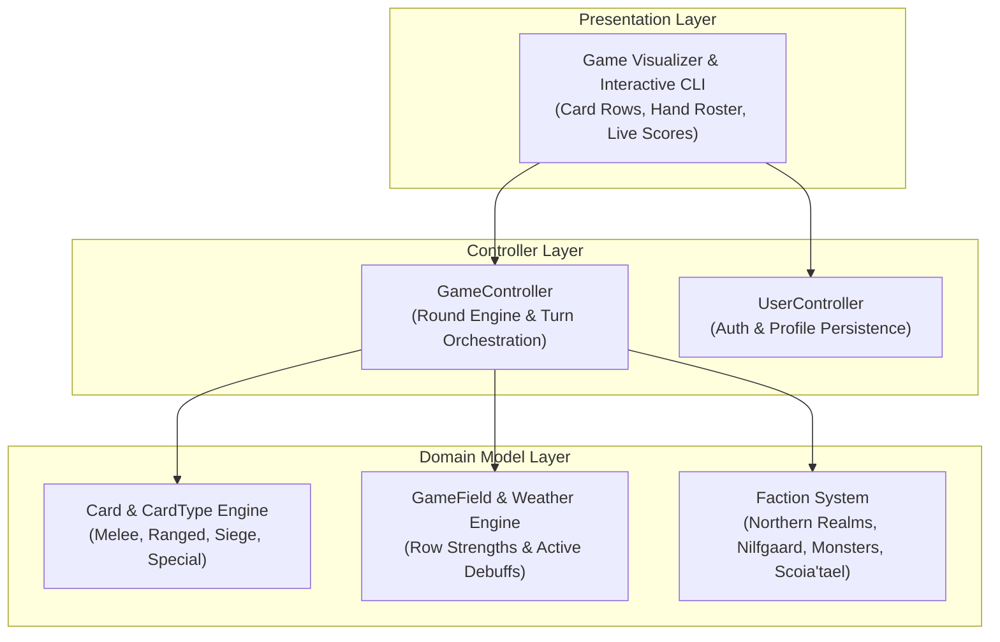

# ⚔️ Gwent — The Witcher Card Game Engine

[](https://openjdk.org/)
[](https://maven.apache.org/)
[]()
[](LICENSE)

A high-performance, object-oriented software implementation of **The Witcher's Gwent Card Game** written in Java 21 LTS. Engineered around a strict **Model-View-Controller (MVC)** architectural design pattern, the engine simulates complex round-based card combat, faction-specific bonuses, weather debuffs, persistent user sessions, and algorithmic game state resolution.

---

## 🏛️ Architecture & Game Engine Design



---

## ✨ Key Technical Capabilities

- **Normalized MVC Separation**: Distinct separation between game state models, user persistence controllers, and terminal/GUI presentation layers.
- **Dynamic Card Mechanics**: Modular strategy pattern supporting special unit abilities: *Morale Boost*, *Tight Bond*, *Medic revival*, *Spy card card-draw*, *Scorch board wipes*, and *Horn multipliers*.
- **Weather System Simulation**: Row-specific weather cards (*Biting Frost*, *Impenetrable Fog*, *Torrential Rain*) dynamically capping unit strengths with instant state re-calculation.
- **Multi-Faction Ecosystem**: Complete rule implementation for all major factions (*Northern Realms*, *Nilfgaardian Empire*, *Monsters*, *Scoia'tael*, *Skellige*) with native passive abilities.

---

## 📂 Source Code Layout

```text
Gwent/
├── pom.xml                   # Maven build configuration & compiler settings (Java 21)
├── src/main/java/
│   ├── controller/           # Game orchestrator, round manager, auth controller
│   ├── model/                # Cards, Factions, GameField, User, RoundResult
│   └── view/                 # Interactive user interface & display renderer
└── README.md
```

---

## 🚀 Build & Run

### Prerequisites
- **JDK 21 LTS** or newer
- **Apache Maven 3.8+**

```bash
# Clone the repository
git clone https://github.com/Hosein1011/Gwent.git
cd Gwent

# Compile and package executable JAR
mvn clean package

# Run the game engine
mvn exec:java -Dexec.mainClass="controller.GameController"
```

---

## 📄 License

This project is licensed under the [MIT License](LICENSE).
